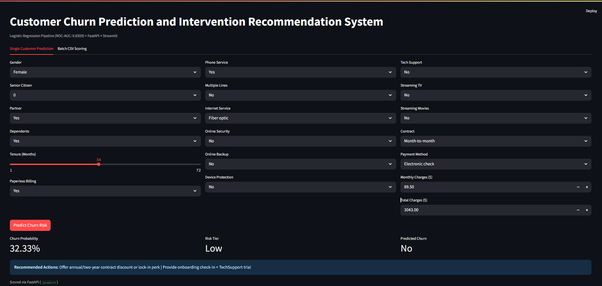
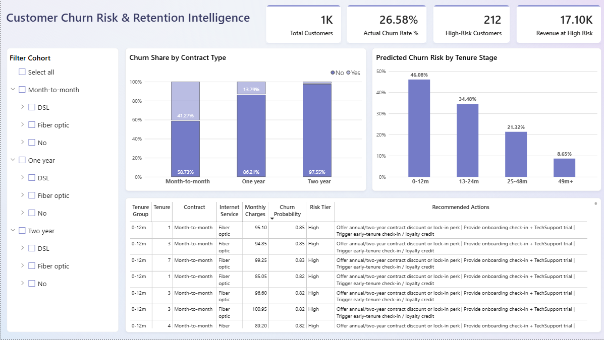

# User Churn Predictor with Intervention Recommender

An end-to-end customer churn prediction, retention action recommendation, and executive business intelligence system for the Telco customer lifecycle.

## Project Overview

Subscription providers lose substantial recurring revenue when high-value subscribers churn without proactive outreach. Rather than stopping at a raw churn probability score, **User Churn Predictor with Intervention Recommender** connects predictive machine learning, tailored retention recommendations, live scoring interfaces, and executive analytics in a single workflow:

1. **Leakage-Free ML Pipeline & Intervention Engine (`Python`, `Scikit-Learn`, `joblib`):** Cleans raw Telco customer data, engineers domain features (`tenure_group`, `charge_ratio`, `active_addons_count`, `high_risk_fiber_mtm`), benchmarks **Logistic Regression**, **Random Forest**, and **Gradient Boosting**, serializes the winning Logistic Regression pipeline (`churn_logreg_pipeline.joblib`), and assigns risk tiers (`High`, `Medium`, `Low`) paired with targeted retention actions.

2. **Backend API (`FastAPI` in `api/main.py`):** Exposes programmatic prediction and retention recommendation endpoints backed by `churn_logreg_pipeline.joblib`.

3. **Interactive Scoring App (`streamlit_app.py`):** Provides an interactive Streamlit interface for single-customer churn probability estimation, what-if scenario testing, and immediate retention playbooks.

4. **Executive Dashboard (`Power BI` & `DAX`):** Consumes `powerbi_churn_data.csv` to monitor cohort churn drivers, KPIs (`Total Customers`, `Actual Churn Rate %`, `High-Risk Customers`, `Revenue at Risk (High Risk)`, `Avg Predicted Churn Prob`), and high-risk accounts requiring immediate outreach.

## System Architecture

```
WA_Fn-UseC_-Telco-Customer-Churn.csv
                 │
                 ▼
  Data Cleaning & Feature Engineering (churn_modeling_pipeline.ipynb)
                 │
                 ▼
  Stratified 80/20 Split ──► ColumnTransformer + LogisticRegression Pipeline
                 │
                 ├──► churn_logreg_pipeline.joblib
                 │          ├──► api/main.py (FastAPI)
                 │          └──► streamlit_app.py (Streamlit)
                 │
                 └──► powerbi_churn_data.csv ──► Customer_Churn_Intelligence.pbix (Power BI)

```

## Model Performance & Retention Logic

Evaluated on the stratified test set ($N = 1,407$, observed churn rate $= 26.58\%$):

* **Logistic Regression (Selected Pipeline):** **0.8359** test ROC-AUC and **79.6%** accuracy—chosen for strong probability calibration, reliable ranking performance, and fast inference.

* **Benchmark Comparison:** Evaluated alongside **Gradient Boosting** and **Random Forest** classifiers under consistent train/test splits.

### Risk Tiers & Intervention Rules

* **High Risk (`prob >= 0.60`):** `212` customers in the test cohort accounting for **`$17.10K`** in monthly recurring revenue at risk.

* **Medium Risk (`0.35 <= prob < 0.60`):** Moderate attrition risk suited for proactive engagement.

* **Low Risk (`prob < 0.35`):** Lower immediate churn likelihood; standard lifecycle communication.

**Action Triggers:**

* `Month-to-month` contract -> *Offer annual/two-year contract discount or lock-in perk*

* `Fiber optic` internet with `TechSupport != "Yes"` -> *Provide onboarding check-in + TechSupport trial*

* `tenure <= 12` months -> *Trigger early-tenure check-in / loyalty credit*

* `MonthlyCharges >= 75` (fallback) -> *Review plan bundle / bill optimization*

## Previews

### Operational Scoring Interface (Streamlit)


### Executive Dashboard (Power BI)


## Repository Structure

```
user-churn-predictor-recommender/
├── api/
│   └── main.py
├── WA_Fn-UseC_-Telco-Customer-Churn.csv
├── churn_modeling_pipeline.ipynb
├── churn_logreg_pipeline.joblib
├── powerbi_churn_data.csv
├── streamlit_app.py
├── Customer_Churn_Intelligence.pbix
├── powerbi_dashboard.png
├── streamlit_ui.png
├── requirements.txt
└── README.md

```

## Setup & Execution

1. **Install dependencies:**

   ```
   pip install -r requirements.txt
   
   ```

2. **Run the Streamlit app:**

   ```
   streamlit run streamlit_app.py
   
   ```

3. **Run the FastAPI backend (optional):**

   ```
   uvicorn api.main:app --reload
   
   ```

4. **Open the Power BI dashboard:**
   Open `Customer_Churn_Intelligence.pbix` in Power BI Desktop linked to `powerbi_churn_data.csv`.
